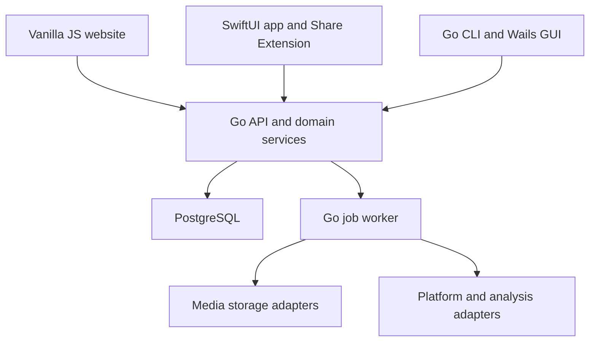
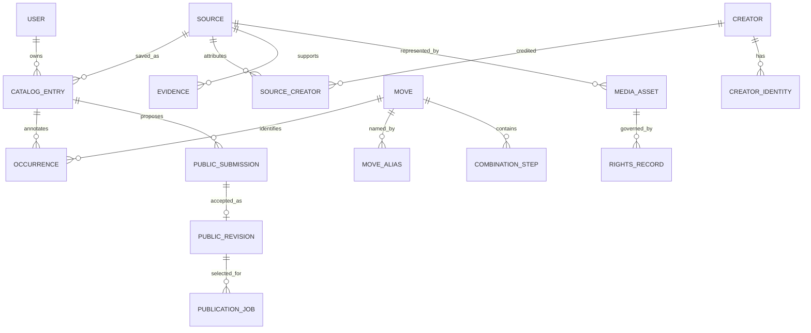

# Vueltario — Product Requirements Document

**Version:** 1.0 · **Date:** November 14, 2026  
**Status:** Implementation-planning draft; assumptions and external integration gates are explicit.  
**Product:** Vueltario · **Website:** https://vueltario.com  
**Instagram destination:** [@cubansocial.sd](https://www.instagram.com/cubansocial.sd/)  
**Platforms:** responsive web, Go CLI, Go + Wails desktop, native SwiftUI iOS.

## 1. Product summary

Vueltario is a personal and community collection of Cuban dance moves (vueltas), including casino, Timba dancing, and rueda de casino. Users save social video links, identify the moves demonstrated, mark their time ranges, and find them again for practice. Original creators remain visible and easy to follow.

One video can contain multiple moves, repeated occurrences, or a named combination. A move can have multiple names and appear in many videos. Personal annotations remain private even when the same source appears in the community catalog.

A separate administrator workflow prepares authorized video assets for Instagram publication to @cubansocial.sd. Instagram-origin content should use a native repost handoff when supported, preserving the original publication. Community publication and Instagram publication are separate decisions.

### Goals

- Make saving and finding a vuelta faster than searching social feeds or saved-post lists.
- Support useful collection management even when automated extraction is unavailable.
- Offer inline playback where the source permits it, with transparent fallbacks.
- Improve move identification through evidence-backed suggestions and user corrections.
- Build a curated community resource that promotes original creators.
- Reuse Go business logic across backend, CLI, workers, and desktop application.

### Non-goals for the initial release

- Universal downloading of arbitrary social videos.
- Guaranteed access to comments, transcripts, or precise playback controls on every platform.
- Automatic identification of unnamed moves from body motion.
- Replacement of source-platform accounts, feeds, comments, or creator subscriptions.
- Events promotion: the existing Cuban Social app remains a separate product.
- Automatic Instagram posting of every public submission.
- Microservices, recommendation feeds, monetization, or extensive social networking.

## 2. Working assumptions and decisions

These defaults allow implementation planning without blocking on unanswered questions.

| Topic | Initial decision | Confirmation needed |
| --- | --- | --- |
| Audience | Administrator-first private pilot, then invited contributors and public read access | Whether open signup is wanted at community launch |
| Hosting | One Go application and worker deployment; same-origin web/API at vueltario.com | Hosting provider, budget, domain/DNS access |
| Identity | Administrator login first; standards-based managed OIDC for community accounts | Identity provider |
| Public catalog | Explicit submission followed by administrator approval | Whether trusted contributors can bypass review later |
| Default visibility | Private | None; intentional product default |
| Instagram text | Caption is the primary metadata text; optional first comment | Whether comments were intended instead of captions |
| Rights | Explicit authorization record before redistribution; linking does not imply permission | Actual source of permissions and music rights |
| Language | Spanish move names; English initial UI with Spanish-ready localization | Whether Spanish UI is required at first release |
| Download behavior | Link-first; authorized acquisition/import is optional and capability-dependent | Any approved creator partnerships |
| Deployment scale | Small community; capacity targets below are planning targets | Expected number of users and videos |

**Naming:** Vueltario is the application, site, and catalog name. Cuban Social is the existing brand/account used as a publishing destination. Neither ownership nor availability of vueltario.com has been verified by this document.

## 3. Personas and authorization

| Role | Capabilities |
| --- | --- |
| Visitor | Search and view approved public records and permitted players; follow creators |
| Member | Maintain private collection, annotate, submit public records, suggest public corrections |
| Trusted contributor, later | Same as member, with configurable review privileges |
| Administrator | Curate shared taxonomy, approve submissions, review reports, manage rights, approve Instagram jobs |
| Worker/service identity | Perform explicitly scoped processing; cannot act as a human reviewer |

A source record being shared across users must not expose who saved it, their private notes, downloaded files, or unsubmitted annotations. Administrators do not receive a general UI for reading private notes. Public correction proposals do not immediately overwrite curated information.

## 4. Core workflows

### 4.1 Save a link

1. User pastes a URL on the website or shares it to Vueltario on iOS.
2. Vueltario creates a private entry immediately and shows its status.
3. A worker normalizes the link, finds an existing source if possible, and retrieves supported metadata.
4. The user can name moves and play the source without waiting for enrichment.
5. Optional suggestions appear separately for review; no guessed name is silently accepted.

### 4.2 Identify and time moves

1. User reviews available title, description, creator, and evidence.
2. User adds one or more moves, creating a proposed term if necessary.
3. Where the player exposes time, Mark start/Mark end captures the current position.
4. User adjusts seconds or MM:SS.mmm values, previews the segment, and saves.
5. If player timing is unavailable, user enters times manually or leaves them unknown.

### 4.3 Share with the community

1. Member selects Submit to community and sees exactly what will be shared.
2. Private notes and private assets are excluded by default.
3. Submission captures a versioned snapshot of proposed public metadata.
4. Administrator approves, requests edits, or rejects with a reason.
5. Approved record becomes visible on the website and in iOS. Public visibility does not grant media redistribution rights.

### 4.4 Publish to Instagram

1. Administrator selects an approved/public record or an explicitly selected administrator-owned private entry.
2. Engine checks source, rights, creator identity, media availability, and platform capability.
3. External-platform content uses an authorized asset and an editable publication draft.
4. Instagram-origin content uses a manual native-repost handoff unless an official automation route is verified.
5. Administrator reviews final video and text and approves that exact draft revision.
6. Job publishes or enters a clearly identified manual/blocked state. Resulting URL and audit history are stored.

## 5. Functional requirements

P0 = required for the phase delivering the feature; P1 = next improvement; P2 = future/research. Priority does not imply all features ship in Phase 1.

| ID | Priority / phase | Requirement and acceptance condition |
| --- | --- | --- |
| ING-01 | P0 / 1 | Accept Facebook, Instagram, TikTok, and YouTube URLs; retain original URL and identify recognized platform. Unsupported hosts receive a clear message without losing input. |
| ING-02 | P0 / 1 | Normalize supported URLs and extract stable post/video identifiers when possible. Preserve meaningful playback offsets separately; remove known tracking parameters only. |
| ING-03 | P0 / 1 | Deduplicate by platform/content ID; fall back to normalized URL. Saving the same source twice returns the existing personal entry or lets the user update it. |
| ING-04 | P0 / 1 | Save entries before asynchronous enrichment. An unavailable metadata API cannot prevent manual cataloging. |
| ING-05 | P1 / 2 | Batch ingestion reports per-item success, duplicates, and failures without aborting the batch. |
| META-01 | P0 / 1 | Store source URL, platform, creator reference, title/description when accessible, and provenance. Unknown fields remain null. |
| META-02 | P0 / 1 | Let users add/edit moves, creators, notes, and occurrences; private overrides do not change another user’s view. |
| META-03 | P0 / 1 | Creator display name and source-profile URL are visible beside playback; missing identity is labeled Unknown creator. |
| TAX-01 | P0 / 1 | Support canonical moves, aliases, proposed terms, combinations, and ordered combination steps. Alias collisions trigger review instead of silent merges. |
| ANA-01 | P0 / 2 | Suggest names from accessible descriptions, authorized audio/transcripts, OCR, and permitted comments. Every suggestion identifies its evidence and processing version. |
| ANA-02 | P0 / 2 | Suggested, user-confirmed, rejected, and administrator-curated states remain distinct. Reprocessing never overwrites confirmed corrections. |
| ANA-03 | P1 / 2 | Suggest temporal ranges only with usable evidence; distinguish an announcement timestamp from the demonstrated movement boundary. |
| ANA-04 | P2 / 5 | Evaluate motion-only recognition separately; ship only after a labeled evaluation establishes useful precision. |
| PLAY-01 | P0 / 1 | Use a provider adapter and official embedded player when eligible; support authorized assets through HTML video. |
| PLAY-02 | P0 / 1 | Explain unavailable/private/deleted/login-required playback and offer an explicit Open original action. Do not redirect automatically. |
| TIME-01 | P0 / 1 | Mark start/end from reliable player time; allow numeric entry and unknown boundaries for all sources. |
| TIME-02 | P0 / 1 | Validate start >= 0, end > start when both known, and bounds against known duration. Permit repeated moves and intentional overlaps. |
| TIME-03 | P0 / 1 | Segment preview seeks/pauses only when supported; indicate approximate embedded-player precision. Do not promise frame accuracy. |
| SEARCH-01 | P0 / 1 | Search canonical names, aliases, title, and creator; filter platform, move, visibility, and asset availability. |
| MED-01 | P0 / 2 | Import authorized files and acquire media only through supported authorized routes. No universal social downloader is a dependency. |
| MED-02 | P0 / 2 | Record stable asset ID, storage key, content metadata, rights, integrity checksum, and source/version mapping. |
| PUB-01 | P0 / 3 | Generate an editable external-source caption with moves, attribution, verified mention if available, follow promotion, source, and branded tags. |
| PUB-02 | P0 / 3 | Instagram-origin drafts omit the extra follow promotion. Native repost limitations are explicit; new uploads must never be labeled native reposts. |
| PUB-03 | P0 / 3 | Require administrator approval tied to draft/asset hash, rights eligibility, destination account, and caption revision. Edits invalidate approval. |
| PUB-04 | P0 / 3 | Prevent duplicate publishing; reconcile ambiguous remote results before another create/publish call. |
| PUB-05 | P1 / 3 | Optional first-comment workflow has separate permissions, status, and retry handling; comment failure never causes video republication. |
| IOS-01 | P0 / 4 | Share Extension accepts URL/text containing supported links, confirms durable local receipt, and returns promptly. |
| IOS-02 | P0 / 4 | iOS defaults to link storage and platform playback. Download/import requires an explicit action and available authorized route. |
| IOS-03 | P0 / 4 | Offline link queue, local notes, and metadata cache synchronize on reconnect without silently dropping edits. |
| COM-01 | P0 / 4 | Private, submitted, published, rejected, withdrawn, and removed states have distinct permissions and history. |
| COM-02 | P0 / 4 | Community submissions, corrections, reports, and administrator decisions are auditable. Public contribution never triggers Instagram publishing automatically. |
| DESK-01 | P0 / 5 | Wails GUI invokes the same Go publishing core as CLI; no duplicated publishing rules. |

## 6. Platform feasibility and verification

**Review date:** November 14, 2026. Verified means an official interface is documented, not that all links or the specific deployment have passed integration tests. Conditional means eligibility, authentication, content settings, or device behavior matters. Requires investigation means no dependable general implementation is established here. Unsupported refers to the proposed general route, not every possible creator-authorized workflow.

| Capability | YouTube | TikTok | Facebook | Instagram |
| --- | --- | --- | --- | --- |
| Public metadata / creator | Verified Data API, subject to availability/quota [S1] | Conditional embeds; Display API covers authorized users’ videos [S5–S6] | Conditional Graph/oEmbed; arbitrary-post access requires investigation [S7–S8] | Conditional oEmbed/approved API scope; arbitrary account access not assumed [S9] |
| Comments | Verified commentThreads API when accessible; replies may need additional calls [S2] | Requires investigation for general consumer app; do not rely on research-only products | Conditional permissions/ownership; arbitrary public comments not assumed | Conditional for app users’ authorized professional media; not universal public-post access [S10] |
| Captions / audio | Caption download requires permission to edit the video; no universal public transcript/audio API [S3] | General audio/transcript extraction unsupported by Display API | No general authorized extraction route verified | No general authorized extraction route verified |
| Web embedded playback | Verified IFrame API; per-video restrictions [S4] | Verified Embed Player; per-video restrictions [S5] | Verified public-video embedded player [S7] | Conditional public compatible posts and embedding settings [S9] |
| Inline iOS playback | Conditional WKWebView integration; device tests required | Conditional webview integration described by Display API [S6] | Conditional webview prototype required | Requires investigation for reliable inline playback; embed availability alone is insufficient |
| Time / seek | Verified getCurrentTime / seekTo [S4] | Verified onCurrentTime / seekTo [S5] | Requires investigation: JS SDK timing/control documentation retrieval was blocked; numeric fallback [S8] | No dependable player-control contract verified; numeric timing fallback |
| Download original from arbitrary link | Unsupported as a general API workflow | Unsupported by Display API | No universal route verified | No universal route verified |
| Authorized original import | Supported by Vueltario’s file-import workflow | Same | Same | Same |

Metadata retrieval must use permitted APIs/embeds and approved scopes. File import is a Vueltario capability, not a guarantee of platform authorization. An embed does not grant extraction or redistribution permission. Comments can be wrong; creator-authored evidence is useful but not definitive.

### Instagram publishing gate

Official documentation supports publishing media to eligible professional accounts and describes login-specific permissions [S11–S12]. Choose Instagram Login first if it satisfies the account setup; its publishing permissions include instagram_business_basic and instagram_business_content_publish. Other login routes have different permissions and Page requirements. Confirm the actual account type, access level, app-review needs, and available endpoints before implementing.

The documented URL-fetch workflow requires media reachable by Meta; a private laptop path cannot be published directly. Use a short-lived externally reachable staging URL for the fetch flow, or validate an officially supported resumable upload route for the selected login [S11]. Keep staging availability sufficient for processing and revoke it afterward.

Instagram native repost is an official user-facing feature [S13]. A supported automation endpoint and arbitrary replacement captions/hashtags for native reposts were **not verified**. Phase 3 must therefore support manual handoff with copyable suggested text and disclose when the native UI cannot attach it. Do not promise that reposting lets Vueltario edit the original caption.

### Dash-separated tags: explicit product requirement

Store and display the requested label exactly as **#CubanSocial-Enchufla**, with a configurable brand prefix. Vueltario equivalents include **#Vueltario-Enchufla**. Default Instagram destination branding remains CubanSocial unless changed by the administrator.

A hyphen must not be assumed to be part of one clickable Instagram hashtag. The official hashtag help page could not be retrieved during this review (HTTP 429), so exact current parsing and limits require a target-account acceptance test [S17]. The implementation must:

1. Persist the requested dash-separated display label independently of platform serialization.
2. Preview it honestly as a label, without claiming a single clickable hashtag.
3. Offer an explicit administrator-selected compatible companion, such as #CubanSocial_Enchufla, after confirming actual parsing.
4. Never silently replace the requested dash or append companion tags without review.
5. Keep caption/mention/hashtag limits configurable and validate the active platform/account behavior rather than freezing an unverified count.

## 7. Architecture and technology decisions

### Recommended implementation

Use a **Go modular monolith**, a Go worker, PostgreSQL, a filesystem-backed asset adapter initially, and vanilla JS ES modules served from the same origin. Use server-side sessions for web clients and an appropriate OIDC native flow with PKCE for iOS/desktop. Keep database access behind the Go API.

PostgreSQL is recommended from the start because the intended product is multiuser with shared records, ownership, transactions, and concurrent jobs. SQLite is a reasonable isolated single-user prototype alternative, but is not the planned shared service. PostgreSQL full-text/trigram search is sufficient initially; no separate search cluster or vector store is required.

Use a PostgreSQL job table with leases and transactional enqueueing; add Redis or a dedicated broker only if measured throughput requires it. One executable can expose server and worker subcommands. Local development may run them in one process; production separates their resource budgets.

### Module boundaries

- Catalog: source normalization, personal entries, taxonomy, occurrences, public snapshots.
- Providers: capability discovery, metadata, embed descriptors, permitted acquisition.
- Analysis: evidence collection, transcript/OCR interfaces, suggestions, evaluation.
- Media: import, validation, probing, derivation, storage, rights eligibility.
- Publishing: draft generation, approval, transport, reconciliation, audit.
- Identity/community: authorization, moderation, reports, sync.

Interfaces must permit fake provider implementations for meaningful contract tests. CLI/Wails clients use the API for shared catalog mutations. A local-only deployment can call the same Go services through an in-process adapter. Tokens for @cubansocial.sd remain in the trusted publishing service, never in website JavaScript or the iOS app.

Use FFmpeg/ffprobe for authorized media inspection and derivation after verifying packaging/licensing for the chosen distribution. Run processing without a shell, with resource/time limits. Choose a transcription/OCR provider through a replaceable interface after cost, privacy, Spanish terminology, and timestamp evaluation. AI is an optional enrichment dependency, never an ingestion dependency.

Wails supports HTML/CSS/JS frontends [S16]. Select and pin an appropriate stable Wails release at implementation time; do not assume examples from different major versions are compatible.

## 8. Entity relationship model and data dictionary

A publication may alternatively reference an administrator-owned private revision; that path does not make it public. Public revisions contain immutable copied occurrence data, not live pointers to another user’s private annotations.

| Entity | Principal fields and rules |
| --- | --- |
| User | UUID, external subject, role, locale, timestamps; no provider credentials in profile payloads |
| Source | UUID, platform enum, platform_content_id nullable, canonical_url, original_url, duration_ms nullable, availability state, metadata_version, fetched_at; unique platform/content ID when known |
| SourceCreator | source_id, creator_id, role (original, uploader, collaborator), provenance; uploader must not automatically be labeled original choreographer |
| Creator | UUID, display_name, biography/reference notes; identity merging requires review |
| CreatorIdentity | creator_id, platform, stable platform ID nullable, handle nullable, profile_url, verification source/date; unique platform/ID where known |
| Move | UUID, canonical_name, normalized_search_key, style tags, kind (move/combination), curation state; name is not the identifier |
| MoveAlias | move_id, alias, language, school/region qualifier, provenance; collisions allowed and surfaced |
| CombinationStep | combination_move_id, ordinal, child_move_id, notes; reject cycles |
| CatalogEntry | UUID, user_id, source_id, private notes, personal title/creator overrides, revision, deleted_at; unique user/source initially |
| Occurrence | UUID, entry_id, move_id or proposed_name, start_ms/end_ms nullable, order, notes, state, timing_method, evidence references, revision |
| Evidence | UUID, source_id, kind, original reference, excerpt, observed offset/range, author role, access scope, retrieved_at, retention deadline; private evidence must not leak to public views |
| Suggestion | target revision, candidate move/range, evidence IDs, model/rules version, confidence band, accepted/rejected state; confidence is not an uncalibrated probability |
| MediaAsset | UUID, source_id, owner/scope, asset_kind, storage_backend/key, device_id nullable, MIME, bytes, SHA-256, duration, dimensions, status, derivation parent, source_time_map, created_at |
| RightsRecord | asset/source scope, grantor, basis, evidence reference, authorized uses/platforms, attribution conditions, expiry/revocation, reviewer; separate video/music concerns |
| PublicSubmission | entry_id, immutable proposed snapshot, status, submitter, reviewer, reason, version |
| PublicRevision | source_id, revision number, curated metadata and occurrences, status, approved_by/at; one active public revision per source initially |
| ProcessingJob | type, target/revision, state, attempts, lease, next_attempt_at, sanitized error, idempotency key |
| PublicationJob | destination, source/public/private revision, selected segments, draft hash, asset hash, caption, optional comment, approval, rights snapshot, container/media IDs, result URL, status |
| AuditEvent / Report | actor, action, target, revision, timestamp, reason; sensitive payloads excluded from general logs |

Store timestamps as integer milliseconds, UTC dates as timezone-aware instants, display dates in the user’s timezone. Unknown differs from zero. Occurrences reference the source timeline. Derived clips use an explicit offset/segment map; edits or replacements that change the timeline invalidate timing until reviewed.

### Scope and conflicts

Source factual metadata can be shared internally, but personal overlays and evidence access are scoped. Public readers receive only approved projections. Source re-fetches do not overwrite confirmed personal/public names. Use version numbers and If-Match/ETag optimistic concurrency; conflicting edits return 409 with a comparison/retry flow. Withdrawn contributor data remains private; removal of an already curated public contribution follows the defined moderation/rights policy and must be explained to the contributor before submission.

## 9. Media lifecycle

Storage resolvers translate asset IDs into usable handles. The database stores keys, not permanent signed URLs. Filesystem keys resolve inside a configured server root; authenticated API streams serve permitted content. Object-storage keys resolve to short-lived signed URLs. Device-local keys include device scope and never masquerade as remotely available files.

Import workflow: authorize action → upload to quarantine → validate MIME/container/size → probe safely → checksum → record rights → create original asset → optional derivatives. A source URL is a web page reference, not automatically a media URL. Preserve original attribution and watermarks unless an explicit authorized editing workflow says otherwise.

Public metadata does not make imported media public. Public asset delivery requires an independent explicit rights/access decision. Imported media defaults private. Publishing staging is temporary and scoped separately from community playback.

Recommended initial configurable ceilings: 500 MiB per upload, ten minutes per processed clip, two concurrent transcodes, and an administrator storage quota. Reject oversize imports before expensive processing. These are operational defaults, not social-platform limits.

Retain originals until owner deletion or rights policy requires removal; cache AI intermediates for at most seven days by default. Expire publishing staging within 24 hours after a terminal job unless an ongoing fetch needs it. Revoke access immediately on deletion, then purge primary bytes within seven days; encrypted backups expire within 30 days. Shared physical blob deletion must respect other valid references and scopes. Nightly orphan scans use a seven-day quarantine before deletion. Back up metadata and assets with a tested restore procedure; periodically verify checksums.

## 10. API and asynchronous processing

REST JSON under /api/v1, same-origin web deployment. All mutations enforce identity, ownership, scope, revision, and rate limits server-side.

| Endpoint | Purpose |
| --- | --- |
| POST /entries | Save link; client request ID for deduplication; return entry/source/job references |
| GET /entries / GET /entries/{id} | Authorized personal search and detail |
| PATCH /entries/{id} | Metadata/private overlay update with If-Match |
| POST/PATCH/DELETE /entries/{id}/occurrences | Add, adjust, or delete personal occurrences |
| GET /moves | Search canonical names and aliases |
| GET /sources/{id}/playback | Scoped embed descriptor or permitted asset handle; never arbitrary executable HTML |
| POST /assets/imports | Authorized import session with size/type checks |
| POST /entries/{id}/analysis | Request supported enrichment and return job ID |
| GET /jobs/{id} | Scoped progress and actionable failure state |
| POST /entries/{id}/submissions | Submit a versioned public snapshot |
| GET /public/entries | Approved public catalog, cursor pagination |
| POST /public/entries/{id}/corrections | Suggest a change without overwriting curated content |
| POST /admin/submissions/{id}/decision | Approve, reject, or request edits |
| POST /admin/publications | Create draft from selected revision/segments |
| POST /admin/publications/{id}/approve | Approve exact draft hash and destination |
| POST /admin/publications/{id}/execute | Execute approved publication; independent idempotency key |
| POST /admin/publications/{id}/reconcile | Resolve ambiguous remote outcome |
| GET /sync?cursor=... | Personal deltas, tombstones, revisions; exclude other users’ private data |

Persist entry and job enqueue in one transaction. Use server-sent events for web progress with polling fallback; iOS initially polls after foreground sync. API keys/secrets never appear in public responses.

**Job states:** queued → running → succeeded; running may become retry_wait, blocked_auth, needs_input, unsupported, failed, or cancelled. Leases permit recovery after worker crashes. Retry transient network/rate-limit failures with bounded exponential backoff/jitter and Retry-After support. Invalid permissions or unsupported capabilities require action, not endless retries. Maximum five automatic attempts initially.

**Publishing states:** draft → needs_rights/needs_asset/ready_for_review → approved → staging → uploading → processing → publishing → published. Alternatives include manual_handoff, retry_wait, blocked_auth, failed, cancelled, and outcome_unknown. Persist remote identifiers before subsequent operations. Outcome_unknown requires reconciliation before retrying a non-idempotent operation.

## 11. UX requirements

### Website

Responsive layout: link input, personal/public catalog switch, search/filter controls, detail view with player, creator attribution, move list, evidence panel, and editing controls. No React or equivalent framework. Native HTML controls and lightweight libraries are preferred. Use untrusted text as text, never raw HTML.

Show Save immediately, then progressive metadata. Mark start/end buttons display captured time. Keyboard shortcuts must be discoverable and avoid firing during text entry. Numeric timing remains available on mobile screens. Evidence is collapsed by default; users see a suggested badge and can inspect why. Show unknown duration and approximate timing accurately.

### CLI and Wails

Proposed CLI groups: ingest, catalog, media import, publish draft, publish preview, publish approve, publish run, publish status, and publish reconcile. Support JSON output, readable errors, meaningful exit codes, dry-run, and account selection. Explicit noninteractive approval must identify the exact draft hash; dry-run never creates a remote post.

Wails provides queue, draft editor, asset preview, rights checklist, destination confirmation, and publication history using the same Go validation. Desktop login uses an appropriate native/browser authentication flow; credentials reside in OS keychain or service secret storage, not plaintext config.

### iOS

The Share Extension accepts NSURL/plain-text links, handles multiple-link text with a selection prompt, and writes a small durable inbox record into an App Group shared with the main app [S14–S15]. Heavy processing is delegated to the backend after authorized submission; the extension must not depend on staying alive. Confirm Saved on this iPhone separately from Synced.

Main app: Inbox, My moves, Community, and Settings. Use SwiftUI with WKWebView wrappers for official web players and AVPlayer for permitted assets. Intercept external navigation so normal playback does not unexpectedly launch another app, while preserving provider-required attribution/navigation behavior. Provide an explicit original-source action when necessary. No offline playback is promised for embeds; cached metadata and imported assets are separate offline capabilities.

SwiftData or SQLite can hold local inbox/cache, keyed to the account. Use App Group coordination for extension writes. Sync mutations carry client IDs and base revisions; offline deletions use tombstones. Logging out isolates/clears account caches according to user choice and never exposes one account’s private data to another.

## 12. Instagram text and tag specification

External-origin example, entirely illustrative:

> Enchufla doble → Dile que no  
> Original video: Creator Name — Source Platform  
> Follow @verified_creator for more Cuban salsa tutorials.  
> Source: original source URL  
> #CubanSocial-EnchuflaDoble #CubanSocial-DileQueNo

Only insert a mention after verification. Otherwise show the creator name/profile URL. Source URLs in captions are attribution text, not guaranteed clickable links. Generate all moves for review, but prioritize selected moves and obey verified destination limits. Never truncate away attribution silently.

Instagram-native repost handoff includes the suggested move information and labels, omits the extra follow promotion, and explains which text the Instagram UI actually permits. If arbitrary additional text cannot accompany a native repost, preserve it in Vueltario and require administrator choice rather than misrepresenting success.

**Normalization:** retain canonical display names, normalize Unicode consistently, remove spaces/punctuation only in the generated move token, and fold accents for the default portable token. Example: Dile que no → DileQueNo. Different moves that normalize to the same token receive stable reviewed disambiguators. The dash between brand and move remains in the display label. Store display_label and platform_hashtag separately. User-selected underscore companions require explicit preview approval.

## 13. Security, privacy, rights, and moderation

- Enforce object-level authorization on every source, entry, evidence, job, and asset endpoint; test guessed IDs and cross-account access.
- Protect URL fetching against SSRF: supported-host allowlist, URL parsing, redirect limits, DNS/IP revalidation, private/link-local/metadata-address rejection, fetch size/time limits. Do not fetch arbitrary player HTML server-side.
- Protect web sessions with Secure/HttpOnly/SameSite cookies, CSRF controls, CSP and narrow frame-src origins. Validate postMessage origins and message schemas for player bridges.
- Use least-privilege OAuth scopes, encryption in transit, secret storage, rotation, redacted logs, and revocation handling.
- Do not collect full comment threads when a small evidence excerpt suffices. Honor platform retention/deletion obligations and revalidate stale cached metadata.
- Explain when audio, video frames, or comments are sent to an analysis provider; allow analysis to be disabled. Private uploads are never made public to enable analysis.
- Distinguish permission to link/embed from permission to download, modify, or republish. Review video and music eligibility separately. Attribution is required but is not a license.
- Public reports cover incorrect naming, misattribution, unavailable source, and rights concerns. Administrators can hide a record immediately, log a reason, and notify the contributor.
- Creator correction/removal requests have a documented contact path. Rights revocation blocks pending publications and removes affected hosted assets; already published Instagram items require a separate tracked remediation action.
- Account deletion removes private notes, credentials, and access; explain retention of independently curated public contributions and required audit records in the public-contribution terms.

## 14. Nonfunctional requirements and operations

Planning envelope: 100,000 source records, 1,000 registered members, 50 concurrent catalog readers; validate before expansion.

| Area | Initial target / verification |
| --- | --- |
| Catalog performance | p95 API read/search < 500 ms under stated load, excluding providers/media transport |
| Link receipt | p95 durable API save < 1 second; UI acknowledgment < 2 seconds on a healthy connection |
| Share Extension | Local durable receipt confirmation within 2 seconds on representative devices; no network dependency |
| Enrichment | First attempt starts within 60 seconds at pilot load; upstream completion has no fixed promise |
| Availability | 99.5% monthly service target for community launch, excluding source-platform availability |
| Accessibility | WCAG 2.2 AA web target; keyboard, visible focus, screen-reader labels, VoiceOver, Dynamic Type, reduced motion |
| Recovery | Daily encrypted backups; initial RPO 24 hours/RTO 8 hours, quarterly restore exercise |
| Portability | Export personal metadata/occurrences as JSON with stable IDs and source URLs; media export only where permitted |
| Observability | Correlation IDs, queue age, provider errors, storage growth, publication outcomes, cost per enrichment; no private content in general telemetry |
| Cost control | Per-user/admin quotas, provider circuit breakers, analysis budget ceiling, no automatic repeated analysis of unchanged sources |

Pin dependencies, maintain database migrations and rollback procedures, and run compatibility smoke tests when platform APIs/player behavior change. Media workers have bounded CPU, memory, disk, and execution time.

## 15. Delivery roadmap

### Phase 0 — Integration spikes and foundation contracts

**Value:** prevent platform assumptions from blocking later development.  
**Deliverables:** provider capability contracts, representative link fixtures, authentication/rights model, storage interface, dash parsing test plan.

**Acceptance/exit:** prototype YouTube and TikTok time/seek in web and iOS WKWebView; test at least one eligible and one restricted Meta source; confirm numeric fallback; inspect target Instagram account eligibility; document native repost as manual unless an endpoint is proven. Record device/browser/API versions. Unresolved integrations receive fallback flags rather than blocking Phase 1.

### Phase 1 — Administrator website MVP

**Value:** useful personal catalog with manual curation.  
**In:** Go/PostgreSQL foundation, private admin login, four-platform URL saving, supported metadata/embeds, manual creator/move entry, aliases, occurrences, search, revision protection, export, backups.  
**Out:** AI, universal downloading, public submissions, automated publishing, Wails.

**Dependencies:** identity setup, representative playback tests, deployment environment.  
**Acceptance:** ingest 20 representative authorized test links across four platforms; all save even if metadata/playback fails; multi-move editing works; repeated source saves deduplicate correctly; timing controls match adapter capabilities; restore a backup.  
**Risks/fallback:** restricted embeds use explicit source link plus manual annotation.  
**Exit:** administrator can save, find, watch where permitted, and correct a vuelta end to end without analysis services.

### Phase 2 — Assisted enrichment and media management

**Value:** reduce manual metadata work and prepare permitted media workflows.  
**In:** durable worker queue, authorized imports, storage abstraction, probing/derivation, evidence and suggestions, transcript/OCR adapters, supported comments, rights records.  
**Out:** motion-only recognition and automatic acceptance of uncertain names.

**Dependencies:** provider access, media/analysis budget, rights policy.  
**Acceptance:** failed acquisition yields import/manual fallback; user corrections survive reanalysis; suggestions always include evidence; imported files remain private; deleted assets become inaccessible; evaluated name suggestions meet the threshold below.  
**Risks/fallback:** metadata-only analysis works when audio access is absent.  
**Exit:** safe file import and reviewed suggestions work reliably with bounded costs. Automated timing may remain disabled if evaluation fails.

### Phase 3 — Instagram CLI

**Value:** repeatable, reviewable publication without manual text assembly.  
**In:** draft/preview/approval, authorized media preparation, caption/tag generation, supported publishing, separate first-comment status if feasible, reconciliation, native-repost handoff.  
**Out:** guaranteed native repost automation, unattended scheduling, desktop GUI.

**Dependencies:** target-account eligibility, approved API scopes/access, rights records, reachable staging/upload route.  
**Acceptance:** dry-run has no external mutation; missing rights/asset blocks publish; exact revision approval required; crash/retry simulation does not duplicate a publication; expired token prompts action; native repost is never reported published until manually confirmed or verified. Test dash labels in the actual caption UI/API.  
**Risks/fallback:** if access approval is unavailable, deliver exportable asset/text and manual handoff.  
**Exit:** administrator completes at least one authorized publication and one native-repost handoff with traceable outcomes.

### Phase 4 — iOS and community catalog

**Value:** collect from the phone and share curated knowledge.  
**In:** SwiftUI app, Share Extension, account isolation, private catalog sync, embedded playback, optional authorized assets, public submissions, moderation, website public browsing.  
**Out:** unrestricted unmoderated publishing and offline embedded video playback.

**Dependencies:** production identity, public access policies, App Group setup, privacy disclosures, platform playback tests.  
**Acceptance:** offline share survives extension termination; reconnect syncs exactly once; rejected submissions remain private; public readers cannot fetch private notes/assets; two users can annotate the same source independently; public entries are visible in both web and iOS.  
**Risks/fallback:** unsupported inline playback has an explicit original-source action.  
**Exit:** invited contributors complete save → correct → submit → approved community view across clients.

**Optional early iOS slice:** move only durable Share Extension link capture and a minimal inbox ahead of Phase 2 if mobile collection is the immediate priority. Do not pull community moderation or full media sync into that slice.

### Phase 5 — Wails and advanced capabilities

**Value:** easier administrator publishing and evidence-led improvements.  
**In:** Wails queue/draft UI, batch workflows, more creator integrations, evaluated timing improvements.  
**Out unless separately validated:** motion-only classification, large social feed, complex recommendations.

**Dependencies:** stable Go publishing core and representative desktop packaging tests.  
**Acceptance:** CLI and GUI produce equivalent drafts/validation for the same inputs; updates preserve credentials securely; batch failures are isolated. Advanced models must beat an agreed baseline on unseen creators.  
**Exit:** desktop workflow operates without duplicate business logic; research features remain optional behind flags.

No calendar estimates are committed until staffing and integration results are known. Each phase remains independently useful; unsupported automation does not hold the catalog hostage.

## 16. Validation strategy and release gates

- **Domain tests:** normalization fixtures, duplicate identities, alias collisions, timestamp bounds, combinations without cycles, revision conflicts, public/private projections.
- **Authorization tests:** cross-user entry/asset/evidence/job access, unapproved public snapshots, moderator actions, account switching.
- **Provider contracts:** documented API responses and failures; live smoke tests on permitted fixtures; restricted/private/deleted/login-required cases. Do not use live provider availability as the only deterministic CI test.
- **Media tests:** malformed/oversize files, safe probing, source/clip time mapping, interrupted uploads, deletion, staging expiry, storage migration checksum comparison.
- **Publishing tests:** approval invalidation, quota/permission errors, expired auth, processing timeout, unknown outcome, crash after remote publication, duplicate requests, comment-only failure.
- **Client tests:** browser keyboard/mobile layout; iOS extension termination/offline/reconnect, WKWebView navigation, VoiceOver and account isolation; Wails packaging on supported desktop OS.
- **Operational tests:** database migration, backup restore, worker lease recovery, fetch SSRF protections, load and analysis-cost ceilings.

Create an administrator-labeled benchmark of at least 50 authorized clips from at least five creators, including music-heavy audio, Spanish terminology, aliases, multiple moves, and missing-name cases. Split evaluation by creator where practical. Report precision, recall, abstention, and correction rate. Initial release gate for high-confidence explicit-name suggestions: >= 90% precision on reviewed held-out suggestions; otherwise label all suggestions unverified and require confirmation. Do not present a model-generated score as a calibrated probability.

For automatic timing, measure boundary error against human labels and report by evidence type. Initial target: at least 80% of suggested boundaries within two seconds; if unmet, disable automatic boundary proposals while preserving manual controls. These are product targets to validate, not claims of current performance.

## 17. Concrete examples

**Multi-move video:** a 90-second lesson contains Enchufla at 00:12–00:22, Dile que no at 00:23–00:30, and another Enchufla at 00:48–00:58. Store three occurrences across two moves. A named combination is a separate entity only if supported by creator/user evidence.

**Correction:** description suggests Enchufla doble, but the user identifies Enchufla. Preserve the rejected suggestion/evidence and save the user’s confirmed occurrence. Reanalysis does not revert it. A public correction requires review.

**Failed embed:** Instagram source saves successfully, but inline playback is unavailable. Detail screen retains creator and move metadata, states the limitation, provides numeric timestamp entry, and offers Open original. No claim of successful playback is recorded.

**Publication:** administrator selects a rights-cleared TikTok original file. Engine creates a caption with move labels and verified creator attribution, previews it, and receives approval for a specific hash. A timeout occurs after publish. Job becomes outcome_unknown, reconciles the stored remote identifier, and records success without creating a second Reel.

## 18. Success metrics

Instrument only the metadata needed to evaluate the product; distinguish platform restrictions from Vueltario failures.

| Metric | Initial target |
| --- | --- |
| Durable valid-link save rate | >= 99% excluding client connectivity failures |
| Save-to-confirmed-move completion | Establish pilot baseline; improve in Phase 2 |
| Find a previously saved move | Median <= 30 seconds in pilot usability sessions |
| Supported-fixture inline playback | >= 95% on tested eligible fixtures; report restrictions separately |
| High-confidence name precision | >= 90% on held-out reviewed suggestions |
| Public submission review time | Target <= 72 hours during staffed pilot |
| Attribution completeness | Every public record has verified creator information or an explicit unknown status |
| Duplicate Instagram publications | Zero caused by retries/idempotency failures |
| Privacy regressions | Zero cross-user private-data exposure; release-blocking |
| Cost | Track cost per processed minute and confirmed useful suggestion before expanding automation |

## 19. Risks and open decisions

| Risk / decision | Impact and response |
| --- | --- |
| APIs and embeds change | Capability registry, versioned adapters, compatibility smoke tests, manual fallbacks |
| Most input has no accessible audio/comments | Link/manual workflow remains first-class; seek creator-authorized originals |
| Dash labels are not single Instagram hashtags | Preserve requested label, verify parsing, offer explicitly approved compatible companion |
| Native repost cannot carry desired text or be automated | Manual handoff and honest capability status; do not upload a copy under the repost label |
| Inconsistent dance terminology | Aliases with school/region context, evidence and curated corrections |
| Wrong creator attribution | Separate uploader/original creator; require identity verification for mentions |
| Copyright/music rights not established | Block redistribution; allow permitted link/embed cataloging |
| Community spam or conflicting edits | Invited rollout, moderation queue, versioned curated snapshots, reports |
| Storage/AI costs | Quotas, budget ceiling, cache by source revision, optional analysis |
| Public contribution withdrawal semantics | Finalize user-facing terms before community launch; distinguish personal deletion, public curation, and rights removal |

Before implementation, confirm: (1) hosting/budget and pilot size; (2) English vs Spanish initial UI; (3) invited vs open community signup; (4) administrator moderation policy; (5) caption vs first-comment preference; (6) rights/creator partnerships; (7) whether compatible companion hashtags should be enabled; (8) whether early iOS capture takes priority over enrichment.

## 20. Official references and verification notes

Reviewed November 14, 2026. These references establish interface availability; target-account approval, mobile compatibility, current limits, and production integration still require the phase-specific checks above. No implementation or account connection was performed for this PRD.

- **S1:** [YouTube videos.list](https://developers.google.com/youtube/v3/docs/videos/list) — metadata contract; implementation should verify requested fields and quotas.
- **S2:** [YouTube commentThreads.list](https://developers.google.com/youtube/data/reference/rest/v3/commentThreads/list) and [comments.list](https://developers.google.com/youtube/data/reference/rest/v3/comments/list) — comment retrieval and replies.
- **S3:** [YouTube captions.download](https://developers.google.com/youtube/data/reference/rest/v3/captions/download) — downloading captions requires permission to edit the video.
- **S4:** [YouTube IFrame Player API](https://developers.google.com/youtube/iframe_api_reference) — embed player, current time, and seeking.
- **S5:** [TikTok Embed Player](https://developers.tiktok.com/docs/en/embed-player) — player messages, current time, and seeking.
- **S6:** [TikTok Display API](https://developers.tiktok.com/docs/en/display-api-overview) — authorized creator metadata, video scopes, and webview use.
- **S7:** [Facebook Embedded Video Player](https://developers.facebook.com/docs/plugins/embedded-video-player/) — public-video embedding.
- **S8:** [Facebook Embedded Video Player JavaScript SDK](https://developers.facebook.com/docs/plugins/embedded-video-player/api/) — retrieval returned HTTP 429; timing/control availability remains unverified and must be validated on target clients.
- **S9:** [Instagram oEmbed reference](https://developers.facebook.com/docs/graph-api/reference/instagram-oembed/) — embedding endpoint; full current requirements need implementation verification. The alternative platform guide returned HTTP 429 during review.
- **S10:** [Instagram comment moderation](https://developers.facebook.com/docs/instagram-platform/instagram-api-with-instagram-login/comment-moderation/) — authorized media comment access; recheck approved scopes before implementation.
- **S11:** [Instagram Content Publishing](https://developers.facebook.com/documentation/instagram-platform/content-publishing) — eligible accounts, login-specific permissions, upload/fetch routes, and publication workflow.
- **S12:** [Instagram platform changelog](https://developers.facebook.com/docs/instagram/platform/instagram-api/changelog/) — Instagram Login permissions and account-integration changes.
- **S13:** [Meta: Instagram repost announcement](https://about.fb.com/news/2025/08/new-instagram-features-help-you-connect/) — user-facing reposts and original attribution; not evidence of a repost automation endpoint.
- **S14:** [Apple Share Extension guide](https://developer.apple.com/library/archive/documentation/General/Conceptual/ExtensibilityPG/Share.html) — extension input, composition, and completion. Archived guide; validate against current SDK behavior.
- **S15:** [Apple App Groups](https://developer.apple.com/documentation/xcode/configuring-app-groups) — shared app/extension containers.
- **S16:** [Wails FAQ](https://wails.io/faq/) — web frontend and Go service integration; pin the selected release.
- **S17:** [Instagram: Use hashtags](https://help.instagram.com/351460621611097) — retrieval blocked by HTTP 429; current parsing and limits remain an explicit integration gate.

## 21. Definition of done

A phase is complete when its acceptance criteria pass on representative clients, authorization and failure paths are verified, migrations and restore steps are documented, limitations are visible in the UI, and no unverified provider capability is presented as guaranteed. Public launch additionally requires moderation operations, privacy/rights disclosures, and a working removal/reporting path. Instagram release additionally requires verified destination-account eligibility and an administrator-approved real publication test.
